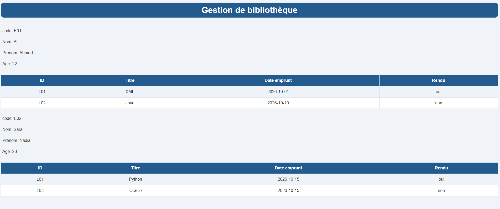

# TP XML – Gestion de bibliothèque

## Présentation

Ce projet présente une gestion simple de bibliothèque avec XML, DTD et XSLT.

- Le fichier `tp.xml` contient les étudiants et les livres qu'ils ont empruntés.
- La DTD `tp.dtd` décrit la structure du document XML et les valeurs autorisées.
- La feuille `tp.xsl` transforme les données XML en une page HTML.
- Le fichier `image.png` contient une capture du résultat obtenu.

## Technologies utilisées

- XML : stockage des données ;
- DTD : validation de la structure du document ;
- XSLT : transformation du document XML en HTML ;
- HTML et CSS : présentation du résultat.

## Structure du projet

```text
.
├── tp.xml       # Données de la bibliothèque
├── tp.dtd       # Règles de validation XML
├── tp.xsl       # Transformation XML vers HTML
├── image.png    # Aperçu du résultat
└── README.md    # Documentation du projet
```

## Fichier XML

Le fichier `tp.xml` déclare la DTD et la feuille de transformation utilisées :

```xml
<?xml version="1.0" encoding="UTF-8"?>
<?xml-stylesheet type="text/xsl" href="tp.xsl"?>
<!DOCTYPE biblio SYSTEM "tp.dtd">

<biblio>
    <etudiant code="E01" nom="Ali" prenom="Ahmed" age="22">
        <livre id="L01" titre="XML"
               dateEmprunt="2026-10-01" rendu="oui"/>
        <livre id="L02" titre="Java"
               dateEmprunt="2026-10-10" rendu="non"/>
    </etudiant>
</biblio>
```

## Fichier DTD

La DTD `tp.dtd` impose les éléments suivants :

- `biblio` doit contenir au moins un étudiant ;
- chaque étudiant doit emprunter au moins un livre ;
- les attributs `code`, `nom`, `prenom` et `age` sont obligatoires ;
- les attributs `id`, `titre` et `dateEmprunt` sont obligatoires ;
- l'attribut `rendu` vaut `oui` ou `non` et a pour valeur par défaut `non`.

```dtd
<!ELEMENT biblio (etudiant+)>
<!ELEMENT etudiant (livre+)>
<!ELEMENT livre EMPTY>

<!ATTLIST livre
    id NMTOKEN #REQUIRED
    titre CDATA #REQUIRED
    dateEmprunt CDATA #REQUIRED
    rendu (oui | non) "non"
>
```

## Fichier XSL

La feuille `tp.xsl` utilise XSLT 2.0. Elle parcourt chaque élément `etudiant`, affiche ses informations dans une liste, puis affiche ses livres dans un tableau HTML.

```xml
<xsl:for-each select="biblio/etudiant">
    <ul>
        <li>Code : <xsl:value-of select="@code"/></li>
        <li>Nom : <xsl:value-of select="@nom"/></li>
        <li>Prénom : <xsl:value-of select="@prenom"/></li>
        <li>Âge : <xsl:value-of select="@age"/></li>
    </ul>

    <table>
        <xsl:for-each select="livre">
            <tr>
                <td><xsl:value-of select="@id"/></td>
                <td><xsl:value-of select="@titre"/></td>
                <td><xsl:value-of select="@dateEmprunt"/></td>
                <td><xsl:value-of select="@rendu"/></td>
            </tr>
        </xsl:for-each>
    </table>
</xsl:for-each>
```

Le CSS est intégré directement dans le fichier XSL afin de mettre en forme le titre, les informations des étudiants et les tableaux.

## Utilisation

1. Ouvrir `tp.xml` dans un navigateur prenant en charge les transformations XSL.
2. Vérifier que les trois fichiers `tp.xml`, `tp.dtd` et `tp.xsl` se trouvent dans le même dossier.
3. Le navigateur applique la feuille `tp.xsl` et affiche les étudiants avec leurs emprunts.

## Résultat


